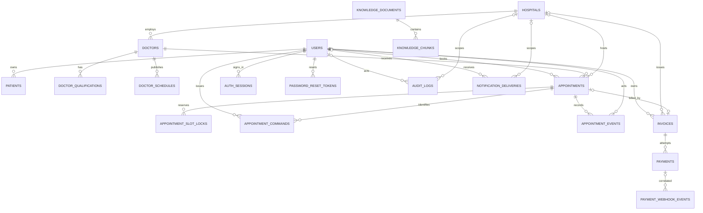

# Database guide

The application uses PostgreSQL 16 through SQLAlchemy 2. Model definitions are in `backend/app/models/`; Alembic revisions in `backend/migrations/versions/` are the deployed schema history. `backend/app/main.py` imports the model package to register metadata. Do not modify a database or run a destructive reset to prepare this documentation.

The table list below reflects the ORM mappings. Confirm actual deployed revision with `alembic current`; a database can be behind or contain legacy rows not represented by current model defaults.

## ER diagram



The crow's-foot symbols show FK relationships, not every ORM `relationship()` property. Many models intentionally use explicit queries rather than bidirectional SQLAlchemy relationships. `User.doctor_id` is unique (at most one user account per doctor profile); `patients.owner_user_id` is nullable and not unique (an account can own multiple profiles). A SQLAlchemy user-to-patient relationship is not declared.

No explicit many-to-many table or ORM mapping appears in the current schema; associations are represented by foreign keys and one-to-many tables.

## Table reference

| Table | Purpose and important fields | Keys, constraints, relationships, main readers/writers |
| --- | --- | --- |
| `users` | Login identity: `id`, `full_name`, unique `email`, `phone_number`, `password_hash`, `role`, `is_active`, `hospital_id`, `doctor_id`, `created_at`. | PK `id`; hospital and doctor FKs; unique email index; unique doctor link. Auth/admin/profile/billing/provider routes read/write. |
| `patients` | Owner-scoped patient demographics: `id`, nullable `owner_user_id`, `full_name`, unique `email`, `age`, `gender`, `created_at`. | PK; owner FK uses `SET NULL`; name/email/owner indexes and unique email. Patient route/service/repository. Legacy unmatched rows may have no owner and must not be exposed. |
| `hospitals` | Clinic/hospital directory/profile: name, city, state, departments, description, address, phone, website, verified flags/status, created time. | PK; indexes include name/city/state/verification status. Referenced by doctors, users, appointments, invoices, audit and notification rows. |
| `doctors` | Clinician profile: hospital, name, specialty, languages, fee in minor units, verified/active, experience, consultation mode, bio, specialties/language/consultation JSON lists, verification state. | PK; optional hospital FK; name/specialty/hospital/verification indexes. Has qualifications and schedules; linked to at most one user. |
| `doctor_qualifications` | Degree/institution/year and verification state per doctor. | PK; `doctor_id` FK `CASCADE`, indexed. Doctor profile API and platform review routes. |
| `doctor_schedules` | Recurring schedule: doctor, weekday, start/end local time, IANA timezone, consultation type, active state. | PK; doctor FK `CASCADE`, indexed. Managed by provider routes; source for slot generation. |
| `appointments` | `patient_user_id`, doctor/hospital, timezone-aware `scheduled_for`, duration (default 30), consultation type, status, notes, created time. | PK; patient/doctor FKs `CASCADE`, hospital FK `SET NULL`; patient/doctor/hospital/time indexes. Provider and admin routes; one appointment may have one invoice (`invoices.appointment_id` unique). |
| `appointment_slot_locks` | Durable occupancy for each appointment slot. | PK; appointment and doctor FKs `CASCADE`; unique `(doctor_id, slot_start)` prevents simultaneous booking; unique `(appointment_id, slot_start)`. |
| `appointment_commands` | Idempotency command record: actor, key, operation, request fingerprint, appointment, timestamp. | PK; unique `(actor_user_id, idempotency_key)`; actor/appointment FKs. Prevents duplicate command execution on retry. |
| `appointment_events` | Appointment history/audit: actor, event type, previous/new status and times, reason, timestamp. | PK; appointment FK `CASCADE`, actor FK `SET NULL`, appointment index. Written on booking and status/time changes. |
| `invoices` | Owner/hospital/optional appointment, unique invoice number, description, `amount_minor`, currency, status, timestamps. | PK; user FK `CASCADE`, hospital/appointment FKs `SET NULL`; unique appointment and invoice number; owner/hospital/appointment indexes. Billing/admin routes. |
| `payments` | Payment attempt: invoice, unique provider order ID, optional unique provider payment ID, status, safe failure code/description, timestamps. | PK; invoice FK `CASCADE`; invoice index. Can have multiple attempts for an invoice. Billing routes/service. |
| `payment_webhook_events` | Provider webhook replay record: unique provider event ID, type, payload SHA-256, optional payment link, result, receive time. | PK; payment FK `SET NULL`; unique event ID and payment index. Billing webhook. |
| `auth_sessions` | Revocable access-token session: UUID-like string ID, user, expiry, revoked/created times. | PK `id`; user FK `CASCADE`; user/expiry indexes. Auth security dependency. |
| `password_reset_tokens` | Hashed one-time reset token, user, expiry, use/creation times. | PK; user FK `CASCADE`; unique token hash; user/expiry indexes. Auth routes only store digest, not raw reset token. |
| `admin_bootstrap_state` | Single-row state for one-time platform-admin bootstrap (`id`, completed, completed_at). | PK; row `id=1` is locked/checked during bootstrap. Bootstrap route. |
| `audit_logs` | Actor/hospital/action/resource IDs, request IP/user-agent, JSON details and timestamp. | PK; actor/hospital FKs `SET NULL`; actor/hospital/action indexes. Audit service and admin reads. Sensitive operational metadata. |
| `notification_deliveries` | Delivery outcome only: optional user/hospital, channel, event type, status, failure code, created time. | PK; user/hospital FKs `SET NULL`; indexes on those IDs. Notification service/admin reads. Not a message inbox. |
| `knowledge_documents` | Approved source metadata: title, URL, publication/update/retrieval dates, version, licence/use/provenance/language/category, active, summary/JSON metadata. | PK; title index; one-to-many with chunks. Ingestion/RAG routes. |
| `knowledge_chunks` | Chunk content, index, embedding JSON list, token count, citation, metadata and creation time. | PK; document FK `CASCADE`, indexed. RAG service reads; ingestion script writes. No PostgreSQL vector extension is declared in this model. |

## Relationship cardinality and important constraints

- A hospital may have many doctors and provider accounts; a doctor can have zero/one hospital because `doctors.hospital_id` is nullable.
- A doctor has many recurring schedules and qualification rows; both are deleted when the doctor is deleted.
- A patient user may own several `patients` profile rows. The browser currently uses the first returned patient profile for its single profile UI.
- A user can book many appointments; a doctor can have many appointments over time. An appointment points to one patient user and one doctor; hospital is nullable for legacy/unaffiliated doctor records.
- Slot uniqueness is the concurrency guard; UI-available slots alone do not guarantee reservation.
- Each appointment can be linked to at most one invoice due to unique `appointment_id`. A null appointment ID is allowed for general service invoices.
- One invoice may have many payment attempts; provider order IDs and non-null payment IDs are unique.
- Knowledge documents have many chunks; deleting the document cascades to chunks.

## Record lifecycle

```text
React form
 -> apiRequest + bearer token
 -> FastAPI path/body/header validation
 -> role/owner/hospital-scope check
 -> route/service/repository logic
 -> SQLAlchemy session + FK/unique constraint checks
 -> commit / rollback
 -> response model
 -> React state update or refetch
```

For example, booking starts in `CareDirectoryPage`, sends a timezone-aware `scheduled_for` and idempotency header to `/providers/appointments`, then the backend creates appointment + slot lock + command + event within a transaction. A conflict produces 409; the UI asks the patient to select another slot. See [end-to-end flows](./END_TO_END_FLOWS.md).

## Migrations and safe schema evolution

`backend/migrations/env.py` points Alembic at `Base.metadata` and configured `DATABASE_URL`. The ordered chain currently runs from `0001_portal_billing` to `0011_appointment_invoices`. The backend container runs `alembic upgrade head` before Uvicorn. Models do not auto-create/alter live schema.

For a new field/table:

1. Decide nullability/default and legacy-row behavior before coding.
2. Change the SQLAlchemy model and Pydantic input/output schema together.
3. Create a new Alembic revision in the backend environment; inspect generated SQL and data backfill behavior.
4. Make upgrade safe for existing rows (add nullable or a safe server default, backfill deliberately, then tighten constraints in a later migration if needed).
5. Add tests for old rows, constraints, ownership, and serialization.
6. Run backend tests, `alembic upgrade head` on an isolated database, `alembic check`, and inspect the resulting schema.
7. Back up valuable data and review the migration before deployment. Do not reset the volume to hide a migration error.

Demo data comes from `backend/app/seed_demo.py`; it is a rerunnable local seeder, not an Alembic migration. Tests use isolated databases and synthetic fixtures. Never run a cleanup/reset against a valuable database just to test a feature.

## Safe PostgreSQL inspection

Use only synthetic records in local development. These commands do not print credentials or delete data:

```sh
docker compose exec -T db psql -U healthcare_user -d healthcare_db
```

Inside `psql`:

```sql
\dt
\d appointments
SELECT id, role, hospital_id, doctor_id, is_active FROM users ORDER BY id LIMIT 20;
SELECT id, owner_user_id, full_name, age FROM patients ORDER BY id LIMIT 20;
SELECT id, hospital_id, full_name, specialty, verification_status FROM doctors ORDER BY id LIMIT 20;
SELECT id, patient_user_id, doctor_id, scheduled_for, status FROM appointments ORDER BY id DESC LIMIT 20;
SELECT id, invoice_number, amount_minor, currency, status FROM invoices ORDER BY id DESC LIMIT 20;
SELECT id, invoice_id, status, provider_order_id FROM payments ORDER BY id DESC LIMIT 20;
```

To use variables from local Compose configuration without printing them in the host output, run queries from the db container's configured environment. Never paste passwords, token hashes, health text, or real identifiers into tickets.

## Missing UI record checklist

1. Identify the authenticated role and verify the account's `hospital_id`/`doctor_id`; do not trust `ahva_user` cached data.
2. Call `/auth/me` and the relevant list endpoint; distinguish API filtering from React rendering.
3. Inspect the exact SQL-backed record and FK references in local synthetic data.
4. Verify row status: directory only shows verified/active records; appointments are role-scoped; patient profiles require matching owner ID.
5. Check logs for 401/403/404/409/500, not just an empty UI.
6. Refresh the page (there is no global live-update cache) and check if the page refetches.
7. If a foreign key or uniqueness condition failed, fix the data/workflow through the supported API or a reviewed migration—not by deleting records blindly.

For commands and common failures, see [Run and debug](./RUN_AND_DEBUG.md).
