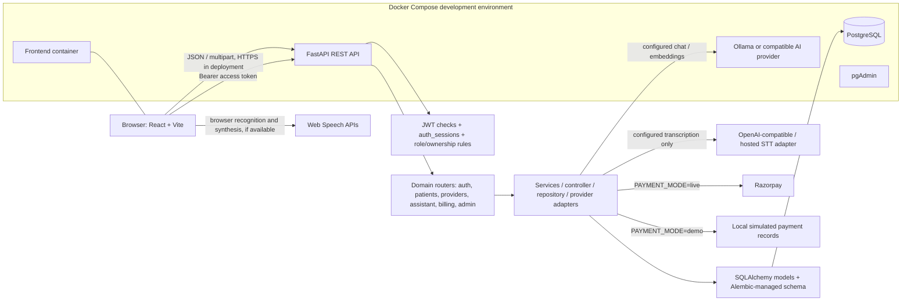

# CareVoice project overview

This is the current-source overview for CareVoice. It is a development-oriented healthcare portal, not a clinically validated or production-ready healthcare service. Use synthetic data only; do not enter real patient or payment-card information. The assistant is not a clinician and cannot rule out emergencies.

## Stack and implementation status

| Area | Evidence in this repository | Status |
| --- | --- | --- |
| Web UI | React 18, JavaScript/JSX, Vite; `frontend/src/main.jsx`, `App.jsx`, and `components/` | Implemented |
| API | Python 3.12 image, FastAPI, Pydantic, SQLAlchemy 2, HTTPX | Implemented |
| Database | PostgreSQL 16 in Compose; SQLAlchemy ORM and Alembic migrations | Implemented |
| Sign-in | Argon2 password hashing, signed JWT access tokens, revocable database sessions, five roles | Implemented |
| Patient profile | Owner-scoped profile CRUD | Implemented |
| Hospital and doctor directory | Verified-only searchable directory, provider profiles, recurring schedules | Implemented |
| Appointments | Schedule-derived slots, booking, confirmation, cancellation, rescheduling, history, idempotency and slot locks | Implemented |
| Payments | Invoice ownership checks; local simulated outcomes; optional Razorpay order, verification, and webhook code | Demo implemented; live integration configured but not verified here |
| Emergency triage | Deterministic string/rule checks for a defined set of English, Hindi, and Hinglish red flags | Implemented, limited and not clinically validated |
| AI chat | Configurable local Ollama or OpenAI-compatible provider, response validation, safety checks | Implemented; live quality and privacy depend on provider configuration |
| Public-health retrieval (RAG) | Opt-in source/chunk storage and retrieval; embeddings stored as JSON | Partially implemented; disabled by default and dependent on curated data/provider |
| Voice input/output | Browser Web Speech recognition/synthesis or configured server-side transcription adapter | Implemented where provider/browser is available; not a hands-free clinical voice workflow |
| Notifications | Optional generic sign-in email/SMS delivery and recorded delivery outcome | Optional; provider delivery is not configured by default |
| Patient-facing notifications inbox | `NotificationsPage` explicitly says the inbox API is not connected | Not implemented |
| Clinical record exchange | No record-sharing workflow or consent API found | Not implemented |

This describes code/configuration, not a claim that external services are available. The project does not establish compliance with HIPAA, India's DPDP Act, or other regulations.

## Architecture

The project is a **modular monolith**: one FastAPI process registers domain routers, which use SQLAlchemy against one PostgreSQL database. The patient profile area has a distinct controller/service/repository chain; provider, assistant, admin, and billing routes contain more of their own domain operations. This is not a uniformly layered MVC application.

The browser does not connect directly to PostgreSQL. The browser submits requests to the API, whose authentication dependency resolves a user and whose route code scopes database queries before reading or writing. External AI, speech, and payment traffic is conditional on configuration. Demo payments do not call Razorpay.

## Request/data path

1. A React page validates basic form state and calls `apiRequest` in `frontend/src/services/api.js`.
2. `apiRequest` adds JSON headers when appropriate, adds the bearer token, calls `VITE_API_BASE_URL`, and converts HTTP/API failures into visible errors.
3. FastAPI validates the path, query, headers, and JSON/multipart body with dependencies and Pydantic models.
4. `get_current_user` verifies the token and its corresponding unrevoked `auth_sessions` row. Route logic then checks role, hospital scope, or resource ownership.
5. A SQLAlchemy session reads/writes ORM rows. Alembic owns schema changes; request handlers commit at deliberate transaction boundaries.
6. FastAPI serializes the response model. React updates local component state; pages generally refetch when a user refreshes or after a successful mutation.

## Important boundaries

- Frontend navigation and disabled buttons are convenience, not access control. Backend checks are authoritative.
- `patients` is a profile table separate from `users`. Registering an account does not itself create a patient profile.
- Doctor and hospital public discovery is restricted to active/verified profiles, but the endpoints still require a signed-in user.
- Appointment availability is computed from published recurring schedules and database slot locks. A displayed slot is not a reservation until booking commits.
- Invoices store amounts in integer minor units (`INR` paise). The server loads payable amount from the invoice; do not trust a browser-supplied payment amount.
- AI triage is keyword/rule based and incomplete. AI chat can send conversation text to the configured model provider. RAG is opt-in and is only as trustworthy as its approved source data and embedding configuration.

## A few terms (simple Hinglish)

- **Modular monolith:** one backend application deployed together, but organized into domain modules. *Ek app process, andar alag-alag zimmedari wale modules.*
- **ORM:** maps Python objects to database rows. *Code se database tables/rows ko read-write karne ka layer.*
- **Tenant scope:** limits a hospital account to that hospital's data. *Hospital A ka staff Hospital B ka private data nahi dekh sakta.*
- **Idempotency:** safely retrying the same request without repeating the operation. *Same booking retry ho to doosri booking create na ho.*
- **RAG:** retrieves approved text before asking the model, then attaches source details. *Model ko jawab se pehle selected reference documents diye jaate hain.*
- **Minor currency unit:** INR amount is an integer number of paise (`100` paise = ₹1). *Payment amount ko integer paise mein rakhne se decimal rounding risk kam hota hai.*

## Where to continue

- [Project structure](./PROJECT_STRUCTURE.md) maps important files and dependencies.
- [Frontend guide](./FRONTEND_GUIDE.md) and [backend guide](./BACKEND_GUIDE.md) explain implementation modules.
- [Database guide](./DATABASE_GUIDE.md), [API reference](./API_REFERENCE.md), and [end-to-end flows](./END_TO_END_FLOWS.md) trace persistent data and requests.
- [Adding features](./ADDING_FEATURES.md) gives repository-specific extension patterns.
- [Run and debug](./RUN_AND_DEBUG.md) covers safe local operation and troubleshooting.
- Existing operational details: [README](../README.md), [deployment notes](./deployment.md), and [speech-to-text notes](./speech_to_text.md). Older standalone architecture material may not reflect all current route/workflow changes; prefer this documentation set and the source when they disagree.
